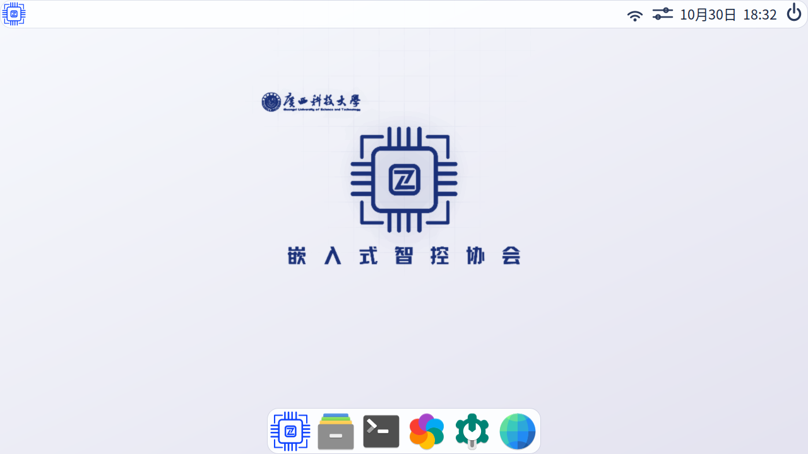
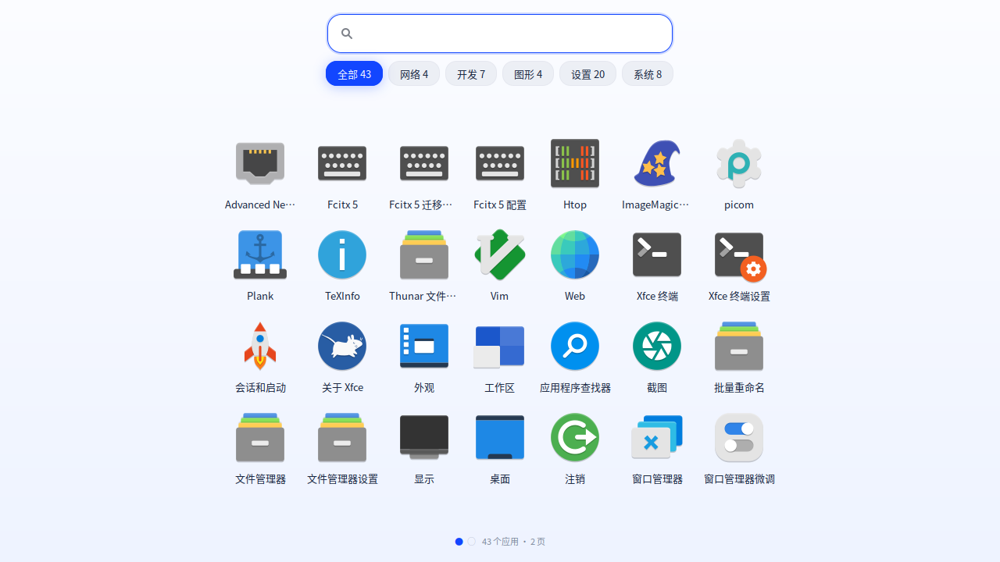
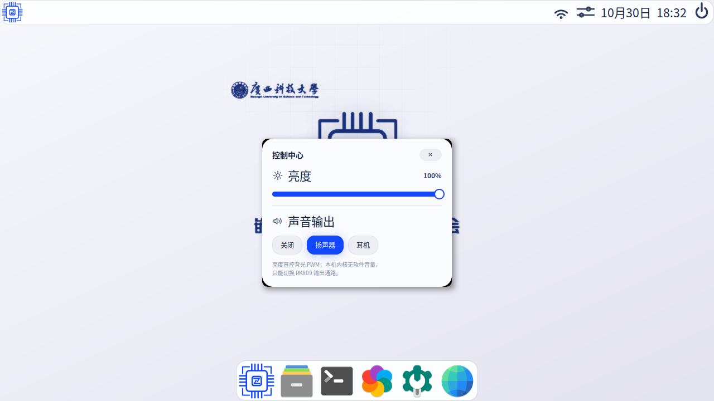
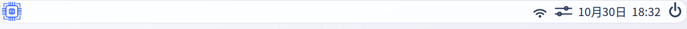

# 3568_ubuntu

为 **M-3568HA / SC-3568HA（RK3568）** 定制的 Ubuntu 22.04 + XFCE 桌面套件：
mac 风格 Dock 与启动台、控制中心、统一浅色主题、MIPI 屏与触屏适配、开机 Logo 与自动登录。

本仓库只包含「桌面层」成果（脚本 / 配置 / 图标 / 壁纸 / 截图 / 面板与屏参），
不含内核、u-boot、根文件系统镜像（`update.img` 约 3 GB，单独交付）。

## 效果



| 启动台 | 控制中心 |
|---|---|
|  |  |



更多截图见 [`docs/pic/`](docs/pic/)，含日历、右键菜单、Dock 特写。

## 硬件与系统

| 项目 | 值 |
|---|---|
| 板卡 | M-3568HA（RK3568，4×A55，Mali-G52） |
| 屏幕 | MIPI DSI0，ILI9881C，720×1280 竖屏，40pin FPC，4 lane，RGB888 |
| 系统分辨率 | 1280×720（横屏使用，DTS 里做 90° 旋转） |
| 触摸 | Goodix GT1X，I2C1 @0x5d，RST=GPIO0_B6，INT=GPIO0_B5 |
| 背光 | PWM4 → SY7200 EN，`/sys/class/backlight/backlight` |
| 系统 | Ubuntu 22.04（Ubuntu Base + XFCE 4.16，X11 + picom） |
| 登录 | lightdm 自动登录 `eica` |

## 主题规范

| 用途 | 颜色 |
|---|---|
| 主色 / 聚焦 / 选中 | `#1246FF` |
| 深色底/标题字 | `#2b3b5c` |
| 正文 | `#16233d` |
| 面板/卡片底 | `#FFFFFF`，阴影 `rgba(0,0,0,0.12)` |

所有聚焦态（分类 chip、搜索框、滑杆、日历今日、菜单悬停、任务栏按钮）统一为
`#1246FF` 底 + 白字反色，规则集中在 `overlay/home/eica/.config/gtk-3.0/gtk.css`。

## 组成

| 路径 | 说明 |
|---|---|
| `overlay/` | 板上实际部署的文件树，**按根路径镜像**，可直接 rsync 到 `/` |
| `overlay/usr/local/bin/m3568ha-launchpad` | 启动台：分类、搜索、7×4 分页、滚轮/触控翻页 |
| `overlay/usr/local/bin/m3568ha-quickpanel` | 控制中心：背光滑杆（PWM 直控）、RK809 输出通路切换 |
| `overlay/usr/local/bin/m3568ha-theme` | 外观一键切换（dark / light / glass） |
| `overlay/usr/local/bin/m3568ha-ctl` | 受限 root 助手（只允许改背光与音频通路） |
| `overlay/usr/local/bin/fullscreen-workspace.py` | mac 风格虚拟桌面：全屏/最大化自动新建工作区并滑动切换 |
| `overlay/usr/local/bin/m3568ha-lock`、`splash-show`、`lcd-rotate.sh` | 锁屏、开机 Logo、显示旋转 |
| `overlay/etc/X11/xorg.conf.d/60-touchscreen-m3568ha.conf` | 触屏 90° 旋转 + 边缘死区补偿矩阵 |
| `overlay/etc/sudoers.d/50-m3568ha-ctl` | 给 `eica` 放行 `m3568ha-ctl` |
| `kernel/lcd-dsi0-mipi-m3568ha.dtsi` | MIPI 屏 DTS（ILI9881C 完整 190 条初始化序列） |
| `docs/pic/` | 效果截图与索引 |
| `docs/touch-calib/` | 触屏边缘探测/五点校准工具与实测样本 |
| `scripts/apply-overlay.sh` | 一键把 `overlay/` 铺到当前系统并重启面板 |

## 部署到板子

```bash
# 板子上（eica 有 sudo）
git clone https://github.com/QZzwj/3568_ubuntu.git ~/3568_ubuntu
cd ~/3568_ubuntu
sudo ./scripts/apply-overlay.sh          # 铺文件 + 修属主
sudo ./scripts/apply-overlay.sh --dry-run # 只看会改什么
```

脚本最后会重启 `xfce4-panel` 与 `picom`；重新登录后生效。

## 屏幕（内核 DTS）

在 `kernel/arch/arm64/boot/dts/rockchip/rk3568-m3568ha-linux.dts` 中引用：

```dts
#include "lcd-dsi0-mipi-m3568ha.dtsi"
```

要点（详见 dtsi 头部注释）：

- 必须发**完整**的 ILI9881C 初始化序列。只发 `SLPOUT + DISPON` 时面板寄存器停在
  OTP 默认态，现象是「不规则黑边 + 内部杂色 / 白→黑渐变 / 闪烁」。
- `lane-rate` 与 `clock-frequency` 需与面板匹配，改错会表现为整屏一亮一灭。
- 电源域 `pmu_io_domains` 里 vccio3/vccio4/vccio5 等要按板子实际电压配置，否则
  Wi-Fi / eMMC / 以太网会随机失效。

## 触屏校准

面板为竖屏、系统横屏，故 X 轴取面板 Y、Y 轴取面板 X 反相；实测可触达区
`x∈[37,1269]`、`y∈[7,714]`（见 `docs/touch-calib/edge-samples.txt`），
再用线性拉伸把死区补掉：

```
0 1.044045 -0.031811
-1.021277 0 1.011348
0 0 1
```

复现/重算：

```bash
python3 docs/touch-calib/edge-probe.py     # 板上全屏滑动，采集极值
python3 docs/touch-calib/calib5.py         # 五点校准对照
```

## 已知限制

- 桌面右键菜单仍是 xfdesktop 默认英文条目（未汉化）。
- 分辨率固定 1280×720，换屏需同时改 DTS 与 `xrandr` 模式。
- `apply-overlay.sh` 假定用户名 `eica`、家目录 `/home/eica`。

## 许可

本仓库自写的脚本、配置、图标、壁纸：随项目自由使用。
其余（Papirus 图标、XFCE 组件、ILI9881C 参数）：遵循各自上游许可。
