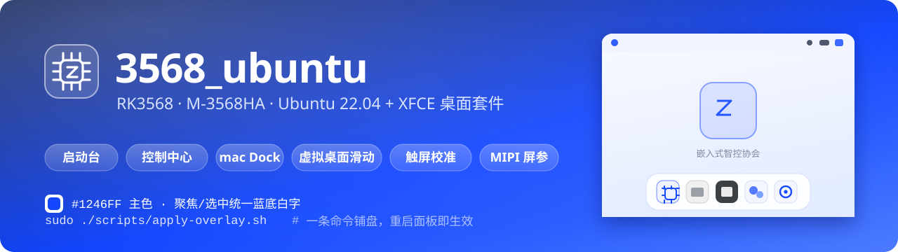

<p align="center">
  
</p>

<p align="center">
  
  
  
  
  
  
</p>

<h3 align="center">让一块 RK3568 工控板，开箱就是一台好看的桌面</h3>

<p align="center">
一条命令把「启动台 + 控制中心 + mac 风格 Dock + 统一浅色主题 + 触屏校准」铺到现有的 Ubuntu 22.04 上，<br>
不改内核、不重装系统、不覆盖用户设置。
</p>

---

## 这是什么

M-3568HA / SC-3568HA（RK3568）出厂通常跑Openharmony，对应的Ubuntu没有适配，而且实验室的板子多，对应的需求也多
本仓库是**这套板子上的桌面层成品**：脚本、GTK 样式、图标、壁纸、XFCE 面板配置、MIPI 屏参和触屏校准矩阵，全部按根路径镜像在 `overlay/` 里，
用 `scripts/apply-overlay.sh` 一次铺到板子上。

| 你会得到 | 说明 |
|---|---|
| 白色浅色桌面 | 统一 `#1246FF` 主色，所有聚焦/选中都是蓝底白字反色 |
| mac 风格交互 | 底部 Dock（悬停放大、按下缩回、激活弹跳）、全屏/最大化自动新建虚拟桌面并滑动切换 |
| 启动台 | 分类 + 搜索 + 7×4 分页网格，滚轮与触控都能翻页 |
| 控制中心 | 亮度直控背光 PWM、RK809 声音输出通路切换，无需命令行 |
| 屏幕 / 触屏可用 | ILI9881C 完整初始化序列 + 90° 旋转 + 边缘死区补偿 |

> 仓库只含「桌面层」。内核、u-boot、根文件系统镜像不进 git（`update.img` 约 3 GB，单独交付），
> 构建方法见 [构建 Ubuntu 镜像](#构建-ubuntu-镜像)。

## 效果


| 启动台 | 控制中心 |
|---|---|
|  |  |

| 顶栏特写 | Dock 特写 |
|---|---|
|  |  |

完整清单（含日历、桌面右键菜单）见 [`docs/pic/`](docs/pic/)。

## 快速开始

板子上（默认账号 `eica`，有 sudo）：

```bash
git clone https://github.com/QZzwj/3568_ubuntu.git ~/3568_ubuntu
cd ~/3568_ubuntu
sudo ./scripts/apply-overlay.sh --dry-run   # 先看会改哪些文件
sudo ./scripts/apply-overlay.sh             # 真正铺盘
```

脚本做三件事：按 `overlay/` 结构 rsync 到 `/`、修正属主、重启 `xfce4-panel` 与 `picom`。
重新登录（或重启 lightdm）后即见新桌面。

想回滚：`overlay/` 是纯文件镜像，把涉及的文件删掉/还原即可，脚本不写注册表式状态、不改内核。

## 构建 Ubuntu 镜像

桌面层只是最后一层。系统镜像是 Rockchip Linux SDK（`rk3568_linux`，本仓库不含）用 `build.sh` 拼出来的：

### SDK 底座与板级增量

SDK（Rockchip Linux SDK，Linux 4.19.232 / U-Boot 2017.09）有两种拿法：`main` 分支只放本板相对底座的增量（9.2 MB），
整套源码在 `sdk-source` 分支（见下一小节）。

`sdk/` 里是 `sdk/patches/` 一个 502 行补丁 + `sdk/files/` 23 个文件（板级 BoardConfig、5 份 DTS、开机 logo、ubuntu rootfs 脚本）。
补丁基于 `github.com/Rosa1337/rk3568_linux` @ `82ca7e638` 验证，详见 [`sdk/README.md`](sdk/README.md)。

```bash
git clone https://github.com/QZzwj/3568_ubuntu.git ~/3568_ubuntu
~/3568_ubuntu/scripts/apply-to-sdk.sh ~/rk3568/rk3568_linux --dry-run   # 先看改什么
~/3568_ubuntu/scripts/apply-to-sdk.sh ~/rk3568/rk3568_linux             # 打补丁 + 覆盖新增文件
```

### 完整 SDK 源码（`sdk-source` 分支）

不想自己准备底座、要一套**开箱即用**的源码树，直接拉 `sdk-source`（工作树 3.47 GB，13 万个文件）：

```bash
git clone -b sdk-source --depth 1 git@github.com:QZzwj/3568_ubuntu.git rk3568_linux
cd rk3568_linux
./build.sh lunch                        # 选 6 → BoardConfig-rk3568-m3568ha.mk（已带 .target_product）
./build.sh kernel && ./build.sh firmware && ./build.sh updateimg
```

分支里**包含**：`device/`（含 5 份 m3568ha DTS + 屏参 + 触摸/DSI 驱动）、`kernel/`（源码，1.02 GB，不含 `.o`/`Image`）、
`u-boot/`、`prebuilts/`（交叉工具链，可按需删）、`rkbin/`、`tools/`、`buildroot/`（`mkfirmware.sh` 要 host tools）、
`external/rkwifibt/`（AP6275S 固件）、`debian/packages/arm64/rkwifibt/`（rootfs 用的 Wi-Fi 固件 deb）。

分支里**不包含**（都是产物或与出镜像无关，不影响 `build.sh` 编译）：

| 未收录 | 体积 | 为什么不影响 |
|---|---|---|
| `ubuntu/` | 19 GB | 全是 `ubuntu-rootfs.img*`（3 GB × 10）产物，源码零跟踪；rootfs 由 `ubuntu/mk-rootfs-ubuntu.sh` 现打 |
| `rockdev/` | 4.2 GB | `build.sh firmware` 现场生成 |
| `external/` 其余 | 4.3 GB | 只需 `rkwifibt`；`libmali`/`rknpu2`/`camera_engine_rkaiq` 是可选预编译库 |
| `debian/` 其余 | 1.2 GB | 只需 `rkwifibt` 的 deb |
| `docs/` | 1.1 GB | 参考文档 |
| `kernel/` 构建产物 | 2.0 GB | `.o`/`vmlinux`/`Image`/`include/generated`，`make` 现生成 |

### 宿主依赖（新机器一次性）

SDK 只带交叉工具链，**宿主机的 kconfig/host tools 要自己装**，缺了会在 `make defconfig` 阶段就报错：

```bash
sudo apt install -y build-essential flex bison bc libssl-dev lz4 device-tree-compiler \
                    python3 rsync qemu-user-static binfmt-support
```

`flex`/`bison` 缺了会报 `scripts/kconfig/zconf.tab.c` 生成失败；预置工具链里自带的 bison/m4 是绝对路径（`/home/<原作者>/...`），换了机器不可用，务必用系统包。

应用之后：

```bash
cd rk3568_linux
./build.sh lunch                        # 选 6 → BoardConfig-rk3568-m3568ha.mk
./build.sh info                         # 核对 RK_KERNEL_DTS=rk3568-m3568ha-linux / RK_ROOTFS_SYSTEM=ubuntu
```

### 打 rootfs（Ubuntu 22.04 + XFCE）

这几个变量必须 `export`，`build.sh ubuntu` 会把环境带进 `ubuntu/mk-rootfs-ubuntu.sh` 的 chroot：

```bash
export RK_ROOTFS_SYSTEM=ubuntu
export USER_NAME=eica USER_PASSWORD=eica ROOT_PASSWORD=123456 TARGET_HOSTNAME=rk3568
export DESKTOP=y                        # 装 xubuntu-desktop，外观随后由本仓库 overlay 覆盖
export EXTRA_PKGS="picom wmctrl python3-xlib xfce4-docklike-plugin xfce4-terminal fonts-noto-cjk"

./build.sh ubuntu                       # → ubuntu/ubuntu-rootfs.img
```

### 出 update.img

```bash
./build.sh kernel                       # 改过 DTS / 驱动才需要，纯桌面改动可跳过
./build.sh firmware                     # 收拢 boot.img / rootfs.ext4 / parameter.txt 到 rockdev/
./build.sh updateimg                    # → rockdev/update.img
```

烧写（板子进 loader / maskrom）：

```bash
sudo tools/linux/Linux_Upgrade_Tool/Linux_Upgrade_Tool/upgrade_tool uf rockdev/update.img
```

### 产物

| 文件 | 内容 |
|---|---|
| `ubuntu/ubuntu-rootfs.img` | 可烧写的 ext4 根文件系统（`mkfs.ext4 -d binary/`） |
| `rockdev/rootfs.ext4` | 同上，`mkfirmware.sh` 建软链后的名字 |
| `rockdev/boot.img` | FIT 打包的内核 + DTB |
| `rockdev/parameter.txt` | `parameter-m3568ha.txt` 分区表（rootfs 10 GB，其余给 userdata） |
| `rockdev/update.img` | 全量升级包 |

现成的 `update.img` 不进 git（3.05 GiB），随 [Releases](https://github.com/QZzwj/3568_ubuntu/releases) 发布。
GitHub 单个 asset 上限 2 GiB，所以分两卷，合并后可用：

```bash
cat update.img0.part update.img1.part > update.img
sha256sum update.img     # 011c43c54eeadbb659372a968e9ef586597e75da5faa6af4eb83be46f76b20a7
```

详见 [`docs/release-notes-v1.0.md`](docs/release-notes-v1.0.md)。

### rootfs 定制变量

| 变量 | 默认 | 说明 |
|---|---|---|
| `RK_UBUNTU_VERSION` / `UBUNTU_RELEASE` | `jammy` | `focal`=20.04、`jammy`=22.04、`noble`=24.04 |
| `UBUNTU_MIRROR` | tuna `ubuntu-ports` | chroot 内 apt 源 |
| `USER_NAME` / `USER_PASSWORD` | `linaro` | 本板设为 `eica` / `eica` |
| `ROOT_PASSWORD` | `123456` | |
| `DESKTOP` | `n` | `y` 装 `xubuntu-desktop` |
| `RK_WIFIBT`（板级配置） | `y` | 装 rkwifibt 固件 + `rk_wifi_init`，NVRAM 固件集由 `RK_WIFIBT_FW_DIR` 钉死 |
| `EXTRA_SIZE_MB` | `500` | ext4 预留空间 |

### 桌面层进镜像的两种方式

| 时机 | 做法 |
|---|---|
| 系统已烧好 | 板上跑 `sudo ./scripts/apply-overlay.sh`（最快，改完重启面板即生效） |
| 想让镜像出厂即带桌面 | `sudo cp -a overlay/. rk3568_linux/ubuntu/overlay/`，再 `./build.sh ubuntu && ./build.sh firmware && ./build.sh updateimg` |

### 注意

- 本板 `RK_CFG_RECOVERY=` 为空（不打包 buildroot recovery），所以 `RK_MISC` 必须保持 `blank-misc.img`；
  换成 `wipe_all` 会写 BCB，开机直接掉进 U-Boot 命令行。
- 屏参改 `kernel/lcd-dsi0-mipi-m3568ha.dtsi`，由 `rk3568-m3568ha-linux.dts` 里的 `#include` 引入。
- 全量 rootfs 要在 chroot 里 `apt install`，耗时取决于网络；只改桌面外观请走 `apply-overlay.sh`，不必重打镜像。

## 板上都有什么

| 路径（= 板上绝对路径） | 说明 |
|---|---|
| `overlay/usr/local/bin/m3568ha-launchpad` | 启动台：分类、搜索、7×4 分页、滚轮/触控翻页 |
| `overlay/usr/local/bin/m3568ha-quickpanel` | 控制中心：背光滑杆（直控 PWM）、RK809 输出通路切换 |
| `overlay/usr/local/bin/m3568ha-theme` | 外观一键切换（dark / light / glass） |
| `overlay/usr/local/bin/m3568ha-theme-ui` | 主题选择的图形界面 |
| `overlay/usr/local/bin/m3568ha-ctl` | 受限 root 助手：只放行改背光与音频通路 |
| `overlay/usr/local/bin/m3568ha-lock` | 锁屏 |
| `overlay/usr/local/bin/splash-show` | 开机 Logo 显示 |
| `overlay/usr/local/bin/lcd-rotate.sh` | 显示旋转 |
| `overlay/usr/local/bin/fullscreen-workspace.py` | mac 风格虚拟桌面守护进程（X11 事件驱动，非轮询） |
| `overlay/usr/local/bin/picom-start.sh` | 合成器启动（工作区滑动动画、阴影、淡入淡出） |
| `overlay/usr/share/themes/m3568ha-light/` | 浅色 GTK3 主题（含 `gtk.gresource`） |
| `overlay/usr/share/icons/hicolor/scalable/apps/` | 自绘 SVG 图标（启动台、控制中心、电源、音量、网络等） |
| `overlay/usr/share/backgrounds/` | 壁纸与开机画面素材 |
| `overlay/usr/share/applications/` | 桌面入口（`.desktop`） |
| `overlay/etc/X11/xorg.conf.d/60-touchscreen-m3568ha.conf` | 触屏 90° 旋转 + 边缘死区补偿矩阵 |
| `overlay/etc/sudoers.d/50-m3568ha-ctl` | 给 `eica` 放行 `m3568ha-ctl` |
| `overlay/etc/lightdm/lightdm-gtk-greeter.conf.d/50-m3568ha.conf` | 登录界面与自动登录 |
| `overlay/home/eica/.config/` | GTK 样式、picom 配置、XFCE 面板/主题/自启动 |
| `kernel/lcd-dsi0-mipi-m3568ha.dtsi` | MIPI 屏 DTS（ILI9881C 完整 190 条初始化序列） |
| `docs/pic/` | 板端实拍效果图与索引 |
| `docs/touch-calib/` | 触屏边缘探测 / 五点校准工具与 1164 条实测样本 |
| `scripts/apply-overlay.sh` | 一键部署（板上铺盘） |
| `scripts/apply-to-sdk.sh` | 一键把板级补丁 + 新增文件贴进 Rockchip Linux SDK |
| `sdk/` | SDK 增量：board/驱动/build.sh 补丁 + 板级配置、DTS、开机 logo、ubuntu rootfs 脚本 |

## 硬件与系统

| 项目 | 值 |
|---|---|
| 板卡 | M-3568HA（RK3568，4×Cortex-A55，Mali-G52） |
| 屏幕 | MIPI DSI0，ILI9881C，720×1280 竖屏，40pin FPC，4 lane，RGB888 |
| 系统分辨率 | 1280×720（横屏使用，DTS 内做 90° 旋转） |
| 触摸 | Goodix GT1X，I2C1 @0x5d，RST=GPIO0_B6，INT=GPIO0_B5 |
| 背光 | PWM4 → SY7200 EN，`/sys/class/backlight/backlight` |
| 系统 | Ubuntu 22.04（Ubuntu Base + XFCE 4.16，X11 + picom） |
| 登录 | lightdm 自动登录 `eica` |

## 主题规范

| 用途 | 颜色 |
|---|---|
| 主色 / 聚焦 / 选中 | `#1246FF`（统一蓝底白字反色） |
| 标题 / 深色底 | `#2b3b5c` |
| 正文 | `#16233d` |
| 面板 / 卡片底色 | `#FFFFFF`，阴影 `rgba(0,0,0,0.12)` |

规则集中在 `overlay/home/eica/.config/gtk-3.0/gtk.css`，分类 chip、搜索框、滑杆、日历今日、
菜单悬停、任务栏按钮全部走同一套聚焦色。

## 屏幕：MIPI DTS

在 `kernel/arch/arm64/boot/dts/rockchip/rk3568-m3568ha-linux.dts` 中引用：

```dts
#include "lcd-dsi0-mipi-m3568ha.dtsi"
```

踩过的三个坑（详见 dtsi 头部注释，可省你几天时间）：

| 现象 | 原因 |
|---|---|
| 不规则黑边 + 内部杂色 / 白→黑渐变 / 闪烁 | 只发了 `SLPOUT + DISPON`，面板寄存器停在 OTP 默认态，必须发完整的 ILI9881C 190 条序列 |
| 整屏一亮一灭 | `lane-rate` 与 `clock-frequency` 与面板不匹配 |
| Wi-Fi / eMMC / 以太网随机失效 | `pmu_io_domains` 的 vccio3 / vccio4 / vccio5 电压配错 |

## 触屏校准

面板竖屏、系统横屏，故 X 轴取面板 Y、Y 轴取面板 X 反相；实测可触达区
`x∈[37,1269]`、`y∈[7,714]`（1280×720 面板，见 `docs/touch-calib/edge-samples.txt`），
用线性拉伸把边缘死区补掉：

```
0 1.044045 -0.031811
-1.021277 0 1.011348
0 0 1
```

复现 / 重算：

```bash
python3 docs/touch-calib/edge-probe.py     # 板上全屏滑动，采集极值
python3 docs/touch-calib/calib5.py         # 五点校准对照
```

## 已知限制

- 桌面右键菜单仍是 xfdesktop 默认英文条目，尚未汉化。
- 分辨率固定 1280×720，换屏需同时改 DTS 与 `xrandr` 模式。
- `apply-overlay.sh` 假定用户名 `eica`、家目录 `/home/eica`；换用户名需同步改脚本与 sudoers。
- 只适配 X11；Wayland 下 picom 动画与部分脚本不生效。

## 许可

本仓库原创部分（脚本、GTK 样式、SVG 图标、壁纸、面板配置、触屏校准矩阵、该 DTS 片段）以 **MIT** 协议发布，
见 [LICENSE](LICENSE)。

随仓库或随系统附带的上游组件保留各自许可：

| 组件 | 许可 |
|---|---|
| Papirus 图标、XFCE 4.16 组件、lightdm | GPL / LGPL（各自上游） |
| ILI9881C 初始化参数（取自面板厂商公开资料） | 沿用原厂资料条款 |
